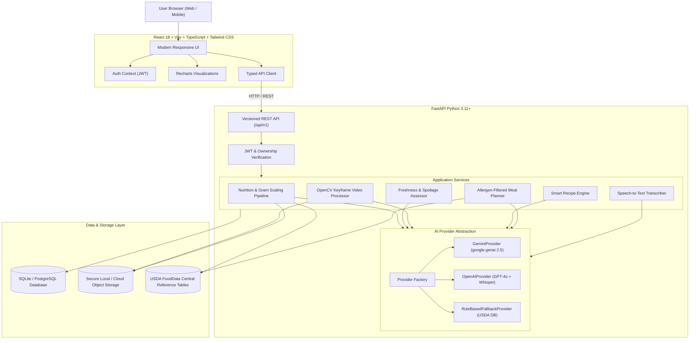

# FoodVerse AI — Multimodal Food Intelligence Platform

A production-ready, full-stack multimodal food intelligence platform that combines computer vision, speech transcription, large language models, verified laboratory nutrition composition data, and user profile persistence to deliver nutrition analysis, freshness checking, commercial kitchen hygiene auditing, smart cooking guidance, and personalized meal planning.

---

## 🌟 Key Features

1. **Food Scanner & Precision Nutrition Analysis**:
   - Multimodal image upload (JPG, PNG, WEBP) with drag-and-drop.
   - Identified food detection with confidence scores.
   - Verified laboratory composition tables from **USDA FoodData Central** and **ICMR Food Tables**.
   - Interactive portion scaling in grams with instant nutrient recalculation (calories, protein, carbs, fat, fiber, sugars, sodium, micronutrients).
   - Dynamic Recharts macronutrient calorie donut charts.
   - Private scan history with isolated user ownership.

2. **Food Freshness & Visible Spoilage Assessor**:
   - Evidence-based visual surface analysis across produce, dairy, poultry, fish, and baked goods.
   - Assessment categories: *No Obvious Visual Spoilage Detected*, *Visible Quality Concerns*, and *Potential Spoilage Indicators*.
   - Explicit microbiological safety disclaimers adhering to scientific truthfulness.

3. **Restaurant & Commercial Kitchen Hygiene Video Monitoring**:
   - Video upload (MP4, MOV, WEBM) with browser playback preview.
   - Keyframe extraction at configurable intervals using **OpenCV**.
   - Visual inspection of glove usage, hair restraints, and surface cross-contamination risks.
   - Timestamped frame observation cards linked to extracted frame thumbnails.
   - Actionable corrective recommendations.

4. **Smart Cooking Assistant & Recipe Builder**:
   - Generates recipes from available ingredients, target cooking times, skill levels, and global cuisines (including authentic Indian dishes with regional spice blends and techniques).
   - Interactive checkable ingredient checklists.
   - Smart substitution suggestions and allergen warnings.
   - Conversational follow-ups (*"Make this higher in protein"*, *"What can I substitute for garlic?"*).
   - Saved recipe library with full-text search.

5. **Personalized Meal Planner with Strict Allergen Safety**:
   - Daily and 7-day weekly meal planning based on user physiological profile and goals (*muscle gain, weight loss, healthy eating, glycemic control*).
   - **Zero-Tolerance Allergen Protocol**: strictly filters out allergens and injects safe substitutions.
   - Consolidated grocery checklist organized by category with purchase checkmarks.
   - Interactive calendar tabs with meal completion toggling.

6. **Central Multimodal AI Assistant**:
   - Conversational voice and text intelligence agent.
   - Integrated speech-to-text audio transcription and in-browser microphone recording.
   - Context-aware reasoning with user dietary goals and past scan history.

7. **Security, Privacy & Data Isolation**:
   - Pure bcrypt password hashing with salt rounds.
   - PyJWT token generation and verification.
   - Server-side MIME validation, size boundary enforcement, and path traversal protection.
   - Private multi-user isolation on all records and full account deletion controls.

---

## 🏗️ System Architecture



---

## 💻 Technology Stack

- **Frontend**: React 18, Vite 5, TypeScript 5, Tailwind CSS, Lucide React, Recharts, React Router v6.
- **Backend**: Python 3.11+, FastAPI, Pydantic v2, SQLAlchemy 2, Alembic, PyJWT, bcrypt, OpenCV (`opencv-python-headless`), Pillow, HTTPX.
- **AI Integrations**: Google GenAI SDK (`gemini-2.5-flash`), OpenAI SDK (`gpt-4o`, `whisper-1`), Verified USDA laboratory database.
- **Database**: SQLite (default local development), PostgreSQL compatible.
- **Testing**: Pytest (backend), Vitest + React Testing Library (frontend).

---

## 🚀 Quickstart for macOS

### Prerequisites
- Python 3.11+ (Python 3.14 verified)
- Node.js v18+ and npm v9+

### 1. Clone & Setup Workspace
```bash
git clone <repo-url>
cd FOODVERSE
```

### 2. Backend Setup
```bash
cd backend

# Create and activate virtual environment
python3 -m venv venv
source venv/bin/activate

# Install dependencies
pip install -r requirements.txt

# Run database migrations
alembic upgrade head

# Start FastAPI backend
uvicorn app.main:app --reload --port 8000
```
Backend will be live at: **`http://localhost:8000`**  
Interactive API Docs (Swagger): **`http://localhost:8000/docs`**  
ReDoc: **`http://localhost:8000/redoc`**

### 3. Frontend Setup
In a new terminal window:
```bash
cd frontend

# Install npm packages
npm install

# Start Vite development server
npm run dev
```
Frontend will be live at: **`http://localhost:5173`**

---

## 🧪 Running Automated Tests

### Backend Test Suite (Pytest)
```bash
cd backend
source venv/bin/activate
pytest -v
```
*Executes all 8 end-to-end tests covering user registration, JWT validation, multi-user isolation, USDA nutrition scaling, freshness safety disclaimers, video frame audits, recipe generation, meal planning with zero-allergen enforcement, and multimodal assistant chat.*

### Frontend Test Suite (Vitest)
```bash
cd frontend
npm run test
```
*Executes Vitest and React Testing Library suites verifying routing, branding, accessibility, and user interaction.*

### Frontend Production Build
```bash
cd frontend
npm run build
```
*Compiles the TypeScript code into an optimized production bundle inside `frontend/dist/`.*

---

## ⚙️ Environment Configuration

### Backend (`backend/.env`)
Copy `backend/.env.example` to `backend/.env`:
```ini
PROJECT_NAME="FoodVerse AI"
API_V1_STR="/api/v1"
SECRET_KEY="your-secure-random-secret-key"
DATABASE_URL="sqlite:///./foodverse.db"
FRONTEND_ORIGIN="http://localhost:5173,http://127.0.0.1:5173"
UPLOAD_DIR="./uploads"

# AI Model Provider ("gemini" | "openai" | "fallback")
LLM_PROVIDER="gemini"

# Credentials (Optional: App operates out-of-the-box in verified USDA mode if empty)
GEMINI_API_KEY=""
OPENAI_API_KEY=""
USDA_API_KEY=""
```

### Frontend (`frontend/.env`)
```ini
VITE_API_URL="http://localhost:8000/api/v1"
```

---

## 🚀 Deployment Guide (Render + Vercel)

### Step 1: Push Code to Your GitHub Repository
1. Initialize or check your git repository:
   ```bash
   git init
   git add .
   git commit -m "feat: complete FoodVerse AI production platform with Groq multimodal vision"
   git branch -M main
   ```
2. Link your remote repository and push:
   ```bash
   git remote add origin <YOUR_GITHUB_REPO_URL>
   git push -u origin main
   ```

---

### Step 2: Deploy Backend to Render (Web Service)
1. Sign in to [Render](https://render.com/) and click **New + > Web Service**.
2. Connect your GitHub repository.
3. Configure the service settings:
   - **Name**: `foodverse-backend`
   - **Root Directory**: `backend`
   - **Runtime**: `Python 3`
   - **Build Command**: `pip install -r requirements.txt`
   - **Start Command**: `uvicorn app.main:app --host 0.0.0.0 --port $PORT`
4. Add **Environment Variables** in Render Dashboard:
   - `LLM_PROVIDER`: `groq`
   - `GROQ_API_KEY`: `your_groq_api_key_here`
   - `SECRET_KEY`: *(Generate a secure 32+ character random string)*
   - `DATABASE_URL`: `sqlite:///./foodverse.db`
   - `FRONTEND_ORIGIN`: `http://localhost:5173,https://your-vercel-domain.vercel.app`
5. Click **Create Web Service**.
6. Once deployed, copy your backend URL (e.g. `https://foodverse-backend.onrender.com`).

---

### Step 3: Deploy Frontend to Vercel
1. Sign in to [Vercel](https://vercel.com/) and click **Add New > Project**.
2. Import your GitHub repository.
3. Configure the project settings:
   - **Framework Preset**: `Vite`
   - **Root Directory**: Click edit and select `frontend`
   - **Build Command**: `npm run build`
   - **Output Directory**: `dist`
4. Add the **Environment Variable**:
   - `VITE_API_URL`: `https://your-backend-name.onrender.com/api/v1` *(replace with your real Render backend URL)*
5. Click **Deploy**.
6. Once deployed, copy your live frontend URL (e.g. `https://foodverse.vercel.app`).

---

### Step 4: Finalize CORS on Render
1. Go back to your Render Dashboard for `foodverse-backend`.
2. Update the `FRONTEND_ORIGIN` environment variable with your actual Vercel URL:
   ```
   https://foodverse.vercel.app
   ```
3. Save changes. Render will automatically redeploy with CORS permissions enabled.

---

## 🐳 Alternative: Docker Compose Deployment

To launch the complete application locally or on a VPS using Docker:
```bash
docker-compose up --build
```
- Frontend: `http://localhost:3000`
- Backend: `http://localhost:8000`
- API Docs: `http://localhost:8000/docs`

---

## 🛡️ Responsible AI & Scientific Boundaries

Please consult [`docs/AI_LIMITATIONS.md`](docs/AI_LIMITATIONS.md) for full scientific guidance:
- **No Microbiological Safety Guarantees**: Surface imagery cannot detect invisible foodborne pathogens (*Salmonella, Listeria, E. coli*). When in doubt, follow public health temperature guidelines.
- **Truthful Calorie Scalers**: Nutritional metrics are derived from verified USDA/ICMR laboratory tables scaled to the entered gram weight.
- **Internal Hygiene Checklists**: Video frame inspection serves as an internal quality tool, not a certified health department audit.
