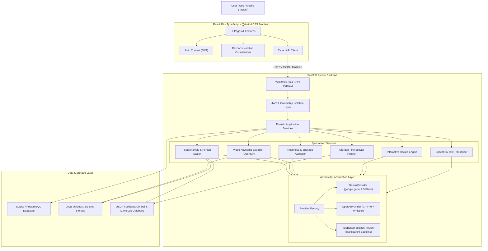

# FoodVerse AI — System Architecture

FoodVerse AI is an enterprise-grade multimodal food intelligence platform engineered with a strict decoupled architecture. It separates presentation, core business logic, verified nutritional reference engines, and neural model provider abstractions.

## High-Level Architecture Diagram

## Core Architectural Principles

1. **Provider Abstraction Layer (`app.services.ai`)**:
   - High-level domain services depend exclusively on `BaseAIProvider` rather than specific SDKs.
   - The active provider is dynamically resolved at runtime via `provider_factory.py`.
   - When no external API key is provided, the system transparently runs in `RuleBasedFallbackProvider` mode rather than hallucinating or pretending live inference took place.

2. **Verified Laboratory Nutrition Pipeline (`app.services.nutrition`)**:
   - Rather than allowing LLMs to guess arbitrary calorie or macro numbers, all nutritional calculations scale deterministically against laboratory composition tables (USDA FoodData Central and ICMR Food Composition Tables).
   - Meal plans aggregate component macronutrients and calories deterministically.

3. **Strict Allergen Exclusion Security**:
   - Allergies (e.g. peanuts, tree nuts, shellfish, dairy, gluten) are treated as zero-tolerance exclusions.
   - Any generated dish containing or referencing declared allergens is automatically filtered or flagged with substitute warnings.

4. **Private Multi-User Data Isolation**:
   - All private resources (`FoodAnalysis`, `FreshnessAssessment`, `HygieneReport`, `SavedRecipe`, `MealPlan`, `Conversation`) enforce strict database-level `user_id` ownership constraints.
   - Users cannot access, view, or delete another user's records by manipulating resource IDs.

5. **OpenCV Keyframe Video Sampling**:
   - Uploaded videos are parsed via `cv2.VideoCapture` with duration and frame limits.
   - Sampled frames are converted to standardized JPEG thumbnails, enabling timestamped visual evidence linking for kitchen hygiene observations.
